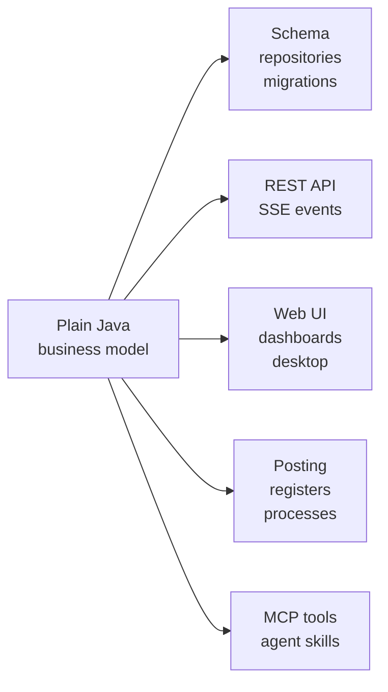

<div align="center">
  <a href="https://onno.su/">
    
  </a>

  <br />
  <br />

  <h1>onno-framework</h1>

  <p>
    <strong>A Java and Spring framework for business software that fits the operation—not the other way around.</strong>
  </p>

  <p>
    <a href="https://central.sonatype.com/artifact/su.onno/onno-framework-starter"></a>
    <a href="https://github.com/onno-erp/onno-framework/actions/workflows/docs.yml"></a>
    
    
    <a href="LICENSE"></a>
  </p>

  <p>
    <a href="https://onno.su/"><strong>Website</strong></a>
    ·
    <a href="https://docs.onno.su/"><strong>Documentation</strong></a>
    ·
    <a href="https://demo.cloud.onno.su/ui"><strong>Live demo</strong></a>
    ·
    <a href="example"><strong>Example app</strong></a>
    ·
    <a href="onno-crm-starter"><strong>CRM module</strong></a>
    ·
    <a href="CONTRIBUTING.md"><strong>Contributing</strong></a>
  </p>
</div>

---

## Write the truth once. Generate the boring parts.

onno models a business as explicit, compiler-checked Java: catalogs, documents, line items,
registers, rules, and durable processes. From that model it generates the infrastructure every
business system needs:

| Model in plain Java | Generated by onno | Kept in your control |
| --- | --- | --- |
| Business entities and references | Database schema and safe migrations | Posting and lifecycle rules |
| Documents and line items | Typed repositories and authenticated REST | Integrations and custom services |
| Balances and historical facts | A role-aware React UI for every entity | Your own pages and components |
| Human and automatic processes | Tasks, events, and MCP tools for AI agents | Every source file and every deployment |

No proprietary designer. No duplicated table, DTO, API, and form definitions. No framework-specific
language for the logic that makes the business unique.

```java
@Catalog(name = "Customers", codePrefix = "C-", context = "Sales")
public class Customer extends CatalogObject {
    @Attribute(length = 200) @NotBlank
    private String name;
}

@Document(name = "Sales Orders", numberPrefix = "SO-", context = "Sales")
public class SalesOrder extends DocumentObject implements Postable {
    @Attribute @NotNull
    private Ref<Customer> customer;

    @TabularSection(name = "items")
    private List<SalesOrderLine> items = new ArrayList<>();

    @Override
    public void handlePosting(PostingContext context) {
        var stock = context.movements(Stock.class);
        items.forEach(line -> stock.addExpense(movement -> {
            movement.setWarehouse(line.getWarehouse());
            movement.setProduct(line.getProduct());
            movement.setQuantity(line.getQuantity());
        }));
    }
}
```

<div align="center">
  <a href="https://demo.cloud.onno.su/ui">
    
  </a>
  <br />
  <sub>The default UI is ready to use and role-aware; an app reshapes it in an ordinary React app. <a href="https://demo.cloud.onno.su/ui">Open the live demo →</a></sub>
</div>

## How it works



1. **Model the operation.** Name the customers, orders, stock, payments, events, and rules the
   company actually works with.
2. **Generate the system.** onno creates the data layer, authenticated APIs, role-aware interface,
   migration plan, and AI-accessible tool surface.
3. **Code what is unique.** Integrations, posting logic, workflows, and policies stay ordinary,
   testable Java in your repository.

## Quick start

onno 2.0 requires Java 21 and Spring Boot 3.4.x. Released artifacts are on Maven Central under
`su.onno`; no credentials or custom repository are required.

```kotlin
plugins {
    java
    id("org.springframework.boot") version "3.4.4"
    id("io.spring.dependency-management") version "1.1.7"
}

repositories {
    mavenCentral()
}

val onnoVersion = "2.0.0"

dependencies {
    implementation("su.onno:onno-framework-starter:$onnoVersion")
    implementation("su.onno:onno-web-starter:$onnoVersion")
    implementation("su.onno:onno-auth-starter:$onnoVersion")
    runtimeOnly("com.h2database:h2")
}
```

Give the app a datasource and a development user:

```yaml
spring:
  datasource:
    url: jdbc:h2:file:./data/app
    driver-class-name: org.h2.Driver
    username: sa

onno:
  auth:
    # Accounts live in the database and are managed at runtime (<UserAccounts />, /api/auth/users).
    mode: database
    # Seeds the first account into the empty store once; it must set a new password at first
    # sign-in, and the list is ignored afterwards. Remove it once you have signed in.
    users:
      - username: admin
        password: change-me-on-first-login
        roles: [ADMIN]
```

Put your annotated model under the `@SpringBootApplication` package and start the application.
onno scans the model, creates the schema, wires the repositories, and serves the UI.

For a complete runnable project with seeded data, posting, commands, role-specific pages,
dashboards, comments, media, and live React components over the shared SSE stream, see the
[Onno Books example](example). For a high-density customer workspace with a unified seeded
multi-channel inbox, replies, internal notes, assignment, lifecycle stages, and opportunities, see
the reusable [CRM starter](onno-crm-starter).

## The UI

With no UI code, the app serves a default React UI: a list and form for every entity the user may
read, navigation grouped by bounded context, register reports, comments and tasks. To shape it, apply
the `su.onno.ui` Gradle plugin and run `./gradlew onnoUiInit`: `src/main/ui` becomes an ordinary
Vite app on [`@onno/ui`](onno-ui/README.md), typed from the Java model, that declares only what
differs.

```tsx
import { defineApp, type EntityCustomization } from "@onno/ui";
import { Check, ClipboardList } from "@onno/ui/icons";
import { Dashboard } from "./pages/Dashboard";

// entities/SalesOrders.ts: how the entity presents, wherever it shows.
const salesOrders = {
  icon: ClipboardList,
  list: { columns: ["number", "date", "customer", "total"], sort: "-date" },
  fields: { total: { format: { money: "USD" } } },
  commands: { approve: { placement: "row", icon: Check } },
} satisfies EntityCustomization<"Sales Orders">;

defineApp({
  entities: { "Sales Orders": salesOrders },
  pages: [{ path: "/", component: Dashboard }],
});
```

Default components are optional: the [UI SDK](docs/UI_SDK.md) exposes the shared record controller,
typed field bindings, list-renderer selection/pagination callbacks, metadata and control props.
A replacement editor or page keeps the same lifecycle without importing private implementation files.

What can be done with records stays in Java: a `Commands<SalesOrder>` bean declares `approve`, its
inputs and who may run it, and the server enforces that on REST, in the UI and over MCP alike.

## Business concepts

| If the business has… | Model it as… |
| --- | --- |
| Master data such as products, customers, warehouses, or employees | `@Catalog` |
| A fixed set of states or categories | `@Enumeration` |
| A dated, numbered event such as an order, invoice, or shipment | `@Document` |
| Repeated rows inside a document | `@TabularSection` |
| Current stock, cash, points, or other balances | `@AccumulationRegister(type = BALANCE)` |
| Revenue, hours, or other period activity | `@AccumulationRegister(type = TURNOVER)` |
| Prices, rates, or other facts that change over time | `@InformationRegister` |
| A singleton business setting | `@Constant` |
| Durable human and automatic work across several steps | `ProcessDefinition<P, S>` |
| A future service or team boundary | `context = "…"` |

The model remains small because references are typed (`Ref<T>`), behavior uses ordinary Java
interfaces and beans (`Commands`, `Checks`), and presentation lives in the React app, not on the
domain classes.

## What ships

| Area | Packages and modules |
| --- | --- |
| Foundation | [`onno-framework`](onno-framework), [`onno-framework-starter`](onno-framework-starter) |
| Application surface | [`onno-web-starter`](onno-web-starter), [`onno-auth-starter`](onno-auth-starter) |
| Composable messaging | [`onno-crm-starter`](onno-crm-starter) |
| Data and integration | [`onno-import-starter`](onno-import-starter), [`onno-print-starter`](onno-print-starter) |
| AI | [`onno-mcp-starter`](onno-mcp-starter) |
| Custom UI | [`onno-ui-gradle-plugin`](onno-ui-gradle-plugin), [`@onno/ui`](onno-ui) |
| Guardrails | [`onno-archunit`](onno-archunit) (ArchUnit rules), [`@onno/ui/eslint`](onno-ui#linting) (lint rules) |
| Consumer examples | [`example`](example) |

Spring Boot starters expose auto-configuration through
`META-INF/spring/org.springframework.boot.autoconfigure.AutoConfiguration.imports`; adding a starter
is enough to make its conditional beans available.

Commercial vertical connectors are distributed separately from the private `onno-enterprise`
repository. Authentication—including OIDC and SSO—remains in the Apache-2.0 open core.

Applications add `implementation("su.onno:onno-crm-starter:$onnoVersion")` and explicitly bind
their existing customer catalog with `CrmCustomerBinding`. The starter supplies messaging and the
`@onno/crm` inbox components; the host owns customers, employees, fields, permissions, pages and navigation.
Assignment, conversation statuses and personal groups are optional. Sales pipelines and metrics
belong to the host application. See the
[composition guide](onno-crm-starter/README.md).

## Designed for humans and AI agents

The same typed model that drives the application also gives agents a safe, inspectable surface:

- `onno-mcp-starter` exposes metadata, reads, writes, register queries, posting, every command, and
  custom `@McpTool` methods with the application's authorization rules.
- The [`onno` agent skills](onno-plugin/skills/onno/SKILL.md) teach coding agents how to model a
  business, author UI, implement posting, evolve schemas, and verify a running application.
- [Building ERPs with onno and AI agents](BUILDING_ERPS_WITH_AGENTS.md) is the end-to-end handoff
  guide for a separate application repository.

Agents produce good code when the codebase makes the wrong thing hard. onno encodes its rules as
types and checks rather than prose:

- **Typed by construction**: `Ref<T>` references, posting as typed Java, getter references instead of
  field-name strings, and startup rejection of invalid models (shared row classes, invalid record
  policies, unsound process graphs).
- **Rules as tests**: add `testImplementation("su.onno:onno-archunit:$onnoVersion")` and
  `OnnoRules.all()` checks your app's architecture (posting outside `@Transactional`, controllers
  through the record-scoped service layer, framework-neutral domain classes); `@onno/ui/eslint`
  does the same for the React side. Every failure message names the fix.
- **Verification an agent can run**: the [`onno-verify`](onno-plugin/skills/onno-verify/SKILL.md)
  skill's `onno-drive` CLI prints the app's feature map and drives it (records, commands, posting
  previews, balances), so pull requests carry evidence instead of claims. Inside the framework,
  jqwik properties check core invariants and a TLA+ model ([docs/formal](docs/formal/README.md))
  checks the process engine's fork/join, cancellation and migration.

Claude Code users can install the skills directly from this repository:

```text
/plugin marketplace add onno-erp/onno-framework
/plugin install onno@onno-framework
```

## Documentation

The complete documentation is published at [docs.onno.su](https://docs.onno.su/), including
hand-written guides, generated configuration reference, and aggregated Javadocs.

| Start here | Purpose |
| --- | --- |
| [Architecture](docs/ARCHITECTURE.md) | Boot pipeline, subsystems, endpoint catalog, and open-core boundary |
| [Configuration](docs/CONFIGURATION.md) | Every `onno.*` property and default, generated from source metadata |
| [Headless Read API](docs/HEADLESS_READ_API.md) | JSON contracts, reference expansion, redaction, and keyset pagination |
| [Running and verification](docs/RUNNING.md) | Local development and authenticated runtime smoke tests |
| [UI tour](docs/UI_TOUR.md) | How `@onno/ui` and an app's `src/main/ui` fit together |
| [UI SDK](docs/UI_SDK.md) | Replace default components using public controllers, bindings and primitives |
| [3.0 release notes](docs/RELEASE_NOTES_3_0.md) | Composable CRM, breaking changes, and upgrade requirements |
| [2.0 release notes](docs/RELEASE_NOTES_2_0.md) | Highlights, breaking changes, and the release gate |
| [Extending onno](docs/EXTENDING.md) | Community connectors, SPI implementations, UI add-ons, and skills |
| [Community integrations](INTEGRATIONS.md) | Generated catalog of third-party projects |
| [Contributing](CONTRIBUTING.md) | Development workflow and contribution guidelines |
| [Java API](https://docs.onno.su/api/) | Aggregated Javadoc for the published API |

Each starter also has a focused README beside its source.

<details>
<summary><strong>Maintaining the generated documentation</strong></summary>

`docs/CONFIGURATION.md` is generated from the starters'
`spring-configuration-metadata.json`. Change a configuration property's Javadoc, then regenerate;
never hand-edit its table.

```bash
./gradlew generateConfigDocs
./gradlew checkConfigDocs
```

Preview the complete docs site:

```bash
./gradlew generateConfigDocs aggregateJavadoc
mkdir -p docs/public/api
cp -R build/docs/javadoc/. docs/public/api/
cd docs
npm install
npm run docs:dev
```

</details>

## Local development

The intended edit loop is **Vite hot reload with a separate backend**, using JDK 21 and Node 22+.
Install the shared npm workspace once with `npm install`, then run from the repository root:

| Terminal | Command | What it runs |
| --- | --- | --- |
| 1 | `npm run dev:backend` | Example backend with DevTools on port 8091. |
| 2 | `npm run dev:watch` | Continuous application Java compilation and typed-model generation. |
| 3 | `npm run dev` | React Fast Refresh at **http://localhost:5173**. |

For frontend-only changes, reuse the running backend and start only `npm run dev`. Pages, styles,
components and linked framework UI sources hot-reload; no jar rebuild or backend restart is needed.
`ONNO_BACKEND` selects a different backend. The backend's packaged UI is a built snapshot;
use the Vite URL while editing. All example modes preserve `example/data/bookstore`.

Use `./gradlew check`, `./gradlew :example:bootJar`, and `./gradlew publishToMavenLocal` for
verification and packaging. Maven-local publication checks sources, Javadoc, POM and binary
artifacts that project dependencies can hide; it is not needed for each edit.

See [Running & verifying](docs/RUNNING.md#intended-development-workflow) for startup, switching
from a packaged backend, Java reload limits, consumer apps and release smoke tests.

## Schema evolution

Structural migrations are derived from the model and diffed against the live database at startup.
`onno.schema.mode` controls whether onno applies, plans, validates, or ignores that diff:

```properties
onno.schema.mode=apply
onno.schema.allow-destructive=false
```

Safe additions, renames, and widening changes apply automatically. Drops and narrowing changes
require an explicit destructive-change opt-in. Use `previousNames` to preserve data through renames
and versioned `AppMigration` beans for backfills or reshaping. Every applied change is recorded in
`onno_schema_history`.

See [Architecture → schema](docs/ARCHITECTURE.md#persistence--schema-migration) for the full
contract.

## Extending onno

Extend the framework without forking it. Community projects can ship connectors, SPI
implementations, UI component packages, MCP tools, or agent skills as separate artifacts. The
[extension guide](docs/EXTENDING.md) documents the contracts, naming rules, and definition of done.
Starters can add public endpoint patterns and CSRF exemptions through `AuthPathsContributor` beans;
see the [auth starter's CSRF model](onno-auth-starter/README.md#csrf-model).

Built one? Add it to [`community/registry.json`](community/registry.json), run
`./gradlew generateIntegrationsDoc`, and open a pull request to list it in
[Community integrations](INTEGRATIONS.md).

## Publishing a release

Releases are tag-driven and published by CI to Maven Central. A tag named `vX.Y.Z` publishes version
`X.Y.Z`, verifies the signed artifacts, and creates a GitHub release:

```bash
git tag v2.0.0
git push origin v2.0.0
```

Pre-releases use tags such as `v2.1.0-rc1` or `v5.0.0-alpha.2` (any version with a `-`). They are
published only to the onno Maven repository, `https://repo.onno.su/releases`; full releases go to
Maven Central and are copied there too. The npm packages (`@onno/ui`, `@onno/crm`,
`@onno/crm-channels`, `@onno/print`) are published in the same run at the same version, to the onno
npm registry `https://npm.onno.su/` (and npmjs.org for full releases, when `NPM_TOKEN` is set).
At most `CENTRAL_MONTHLY_RELEASES` (default 4) full releases a month go to Central — its free tier
counts files per month — so test a release as `-rc1` first. Published versions are immutable, so
publishing is intentionally CI-only. See
[`.github/workflows/publish-packages.yml`](.github/workflows/publish-packages.yml) for the required
Central Portal, registry and signing secrets, and [Consuming releases](docs/CONSUMING.md) for the
consumer side.

## Contributing

Issues, focused pull requests, and community extensions are welcome. Start with
[CONTRIBUTING.md](CONTRIBUTING.md), keep public API changes documented, and run the narrowest useful
tests followed by `./gradlew clean check`.

## License

The framework modules in this repository are open source under the
[Apache License 2.0](LICENSE). See [NOTICE](NOTICE) for attribution.

Commercial vertical connectors live in `onno-enterprise`, use the `su.onno.enterprise` Maven group,
and are governed by a separate commercial license. The
[module split plan](docs/licensing/MODULE-SPLIT-PLAN.md) documents the open-core boundary.

<div align="center">
  <br />
  <strong>Your business is not generic. Your software should not be either.</strong>
  <br />
  <sub><a href="https://onno.su/">onno.su</a> · <a href="https://docs.onno.su/">docs</a> · <a href="https://github.com/onno-erp/onno-framework/issues">issues</a></sub>
</div>


The [CRM channel starter](onno-crm-channels-starter) can receive and reply to
private Telegram text chats using an opt-in bot connection. The reusable CRM module exposes
[`CrmMessageTransport`](onno-crm-starter/README.md#message-delivery-contract) for host-owned channel
adapters.

The CRM starter supports application-authored inbox workspaces with independent chat-selection
rules, folders, presentation and team read/write permissions. See
[the CRM workspace contract](onno-crm-starter/README.md#inbox-workspaces-and-channel-accounts).

### Ready-made CRM channels

`su.onno:onno-crm-channels-starter` packages opt-in Telegram, Gmail, Instagram, and WhatsApp adapters on top of the reusable CRM. See [setup, limitations, and local webhook testing](onno-crm-channels-starter/README.md). Adopter skills are in [onno-crm-adopt](onno-plugin/skills/onno-crm-adopt/SKILL.md), [channel setup](onno-plugin/skills/onno-crm-channel-setup/SKILL.md), and [channel debugging](onno-plugin/skills/onno-crm-channel-debug/SKILL.md).

CRM message bodies can be drawn by the app with `<CrmInbox messageRenderers={[…]} />`. Record tags
(stable IDs, colors, authorized assignments) render with `@onno/ui`'s `<EntityTags />`; see
[onno-web-starter](onno-web-starter/README.md#tags--apitagskindname). Apps add buttons and panels
to named outlets (`ExtensionSlot`) with `defineApp({ extensions })`; see
[the extension guide](docs/EXTENDING.md#ui-contributions).

CRM conversation-status definitions, colors, and transitions are authored in application Java (`CrmStateConfiguration`); the application's React code owns header and template buttons. See [the extension guide](docs/EXTENDING.md).

CRM channels use extensible string keys with connector-owned `CrmChannelDefinition` metadata
(`GET /api/crm/channels/types`); no fixed channel enumeration or Channels page is installed.
`<CrmConnections setups={[channelSetups]} />` takes provider setup forms as components; bundled provider
setup and branding live in the channels starter (`@onno/crm-channels`). The inbox's columns, sort and
filters are `<CrmInbox list={…} />` props. Status bindings read an existing host
catalog or enumeration through `CrmStateConfiguration.catalog(...)`/`.enumeration(...)`, with no
CRM status table or mirrored records. Channel keys and status UUIDs are breaking storage changes.

CRM Connections supports host-configured shared/personal sections, provider availability and
account lifecycle controls. Gmail supports multiple mailboxes with owner-scoped personal inboxes;
other bundled adapters currently remain shared-only. See [scoped connections](onno-crm-starter/README.md#scoped-connection-accounts).
